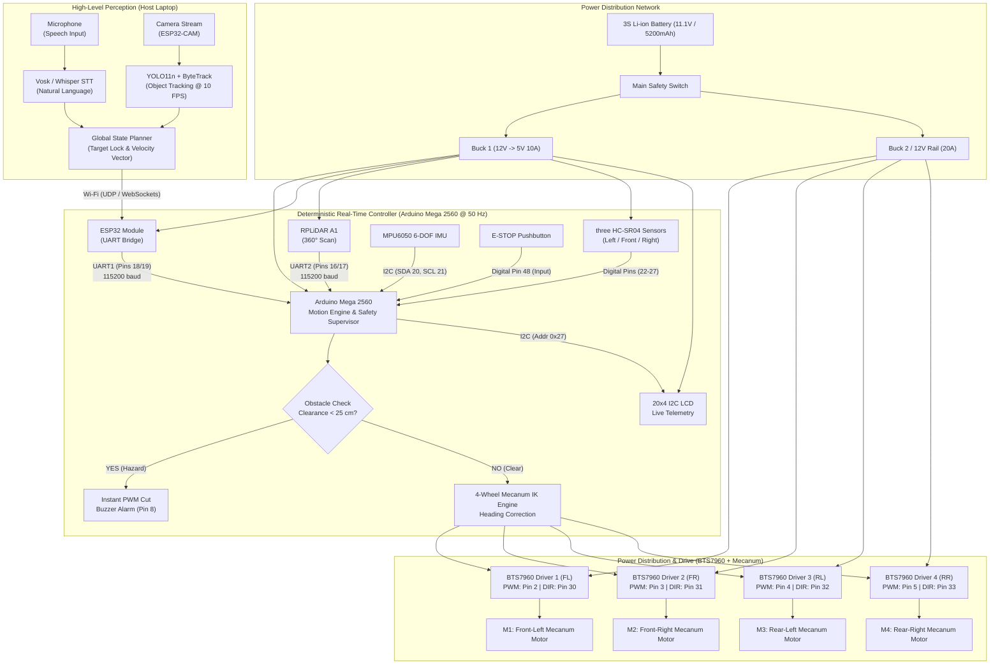

MECAVISION: Vision-Based Autonomous Mecanum Robot

> **Team: Tech Minions**  
> **Team Members:**  
> - **Bhawna Singh** — *Perception, Computer Vision & Machine Learning*  
> - **Aditya Singh** — *Embedded Systems, Power Distribution & Circuit Design*  
> - **Harshit Vats** — *Kinematics, Trajectory Planning & Control Systems*  

---

## Table of Contents
1. [Project Overview](#project-overview)
2. [Hardware Components and Technical Specifications](#1-hardware-components--technical-specifications)
3. [Circuit Diagrams, Wiring and System Architecture](#2-circuit-diagrams-connections-and-system-architecture)
4. [Running the Simulations](#3-running-the-simulations)
   - [3D Simulation](#a-3d-simulation)
   - [2D Simulation](#b-2d-simulation)
   - [Wokwi Circuit](#c-wokwi-circuit)
5. [Planned Physical Build](#4-planned-physical-build)
   - [Chassis Layout](#chassis-layout)
   - [Mecanum Wheel Movement](#mecanum-wheel-movement)
   - [How the Control System Is Split](#how-the-control-system-is-split)
6. [Simulation Limits and Next Steps](#5-simulation-limits-and-next-steps)
   - [What May Change on the Physical Robot](#what-may-change-on-the-physical-robot)
   - [Suggested Build Order](#suggested-build-order)
7. [Repository Structure](#repository-structure)

---

## Project Status

The project currently includes browser-based simulations and a Wokwi circuit for trying out the design and control logic. The physical robot has not yet been fully assembled and tested, so its real-world performance is not confirmed. Parts, wiring, and build steps in this README describe our planned implementation unless stated otherwise.

---

## Project Overview

Robots are often used to move items around places such as warehouses, hospitals, and campuses. A robot that follows fixed lines can be limited when its route needs to change.

MECAVISION is our proposed vision-based mobile robot. The goal is to let a user give a simple command, such as *"Go to the chair"* or *"Find the person"*, and have the system identify the target and guide the robot toward it. Four mecanum wheels are planned to support forward and backward movement, sideways movement, and turning. The Arduino will manage low-level movement and obstacle-safety checks, while a host computer will handle the more demanding vision tasks.

---

## 1. Hardware Components & Technical Specifications

The table below lists the parts selected for the planned prototype. Exact models and ratings should be checked against the components available for the final build.

### Planned Parts and Specifications

| Component | Qty | Part / Model | Operating Voltage | Current / Power Draw | Technical Specifications & Role |
|---|:---:|---|:---:|:---:|---|
| **Main Real-Time Controller** | 1 | **Arduino Mega 2560 Rev3** | 5V DC (USB / External Buck) | ~50 mA | ATmega2560 @ 16 MHz, 256 KB Flash, 8 KB SRAM, 54 digital I/O (15 PWM), 16 analog inputs, 4 hardware UARTs. Planned for motion control, inverse kinematics, sensor readings, and emergency-stop handling. |
| **Wireless Communications Bridge** | 1 | **ESP32-WROOM-32D** | 3.3V / 5V DC | 80–240 mA | Xtensa Dual-Core 32-bit LX6 @ 240 MHz, 802.11 b/g/n Wi-Fi & Bluetooth v4.2 BR/EDR/BLE. Planned to pass movement commands and status data between the host computer and Mega over UART1 (115200 baud). |
| **360° Laser Rangefinder** | 1 | **Slamtec RPLiDAR A1M8** | 5V DC | ~600 mA (spin-up) / ~350 mA (run) | 2D laser triangulation, 12 m radius range, 360° omnidirectional scan @ 5.5–10 Hz, 2000–4000 samples/sec, resolution ≤1% of distance. Provides distance measurements for obstacle mapping over UART2 (115200 baud). |
| **Ultrasonic Distance Sensors** | 3 | **HC-SR04** | 5V DC | 15 mA per sensor | 40 kHz acoustic transducer, 2 cm to 400 cm range, 3 mm accuracy, 15° cone measuring angle. Mounted Left (-90°), Front (0°), and Right (+90°) for close-range blind-spot safety reflexes. |
| **High-Current Motor Drivers** | 4 | **BTS7960 43A H-Bridge Module** | 6V – 27V (Motor), 5V (Logic) | 43A peak limit per module | Dual half-bridge with Infineon BTS7960 chips, 25 kHz PWM capability, thermal shutdown, reverse polarity and short-circuit protection. One module is planned for each drive motor, using PWM for speed and a direction signal. |
| **DC Geared Drive Motors** | 4 | **12V Planetary DC Motors + Encoders** | 12V DC nominal | 0.8A no-load, 7.5A stall per motor | 300 RPM nominal output, high stall torque ~7.5 kg·cm, integrated dual-channel optical/magnetic quadrature encoders (11 PPR, gear ratio 34:1 → 374 pulses per wheel revolution). |
| **Omnidirectional Wheels** | 4 | **97mm Heavy-Duty Mecanum Wheels** | N/A | N/A | 2 Left-hand and 2 Right-hand 45° angled barrel rollers with dual ball bearings per roller, vulcanized rubber tread, aluminum hub plate, load capacity up to 15 kg per wheel. |
| **6-DOF Inertial Measurement Unit** | 1 | **MPU-6050** | 3.3V – 5V DC | 3.8 mA | 3-axis gyroscope (±250/500/1000/2000 °/s), 3-axis accelerometer (±2/4/8/16g), 16-bit ADC, I2C fast mode (400 kHz). Can be used to measure rotation and help correct heading drift; performance will depend on calibration and the control code. |
| **Operator Status Display** | 1 | **20x4 Character LCD (I2C)** | 5V DC | 25 mA (with LED backlight) | HD44780 controller with PCF8574 I2C backpack @ address `0x27`. Displays robot state, target object, ultrasonic ranges, battery voltage, and motor duty cycles in real time. |
| **Warning Piezo Buzzer** | 1 | **Active 5V Piezo Buzzer** | 5V DC | 30 mA | 85 dB @ 10 cm, 2.3 kHz resonant frequency. Audible alarms for obstacle detection (<42 cm pulse, <25 cm continuous emergency alarm). |
| **Hardware Emergency Stop** | 1 | **Industrial Mushroom Pushbutton** | Up to 250V / 10A | Passive | Normally Closed (NC) switch planned as a physical disconnect on the main power bus, with a separate logic input to report the stop state to the Mega. |
| **Main Power Source** | 1 | **3S 18650 Li-ion Battery Pack** | 11.1V nominal (12.6V max) | 25A continuous discharge | 3S2P configuration (6 cells), 5200 mAh capacity, integrated BMS with over-current, over-charge, and short-circuit protection. |
| **Logic Step-Down Converter** | 1 | **DC-DC Buck Converter 1** | Input: 12V DC, Output: 5V DC | 10A peak | High-efficiency (96%) synchronous step-down regulator powering Arduino Mega, ESP32, RPLiDAR, HC-SR04 sensors, and LCD. |
| **Motor Power Conditioning** | 1 | **DC-DC Buck/Filter Converter 2** | Input: 12V DC, Output: 11.1V–12V | 20A peak | High-current LC filter & heavy decoupling rail buffering high inductive surge current from four BTS7960 drivers. |

---

## 2. Circuit Diagrams, Connections and System Architecture

### Circuit Diagram

The current circuit screenshot is included below for reference. It shows the Arduino Mega, three ultrasonic sensors, an LCD, a buzzer, a push button, a motion sensor, and LED indicators. The full MECAVISION design also includes components that may not appear in this screenshot, such as the motor drivers, motors, ESP32, and LiDAR.


> **Wiring note:** The pin table below describes the planned connections. Before building, compare it with the final Wokwi diagram and Arduino sketch; the screenshot alone does not make every pin connection readable. The ESP32 uses 3.3 V logic, so check UART voltage compatibility and use level shifting where needed.

### System Overview



---

### Wiring and Pin Connections

| Microcontroller Pin | Subsystem / Component | Component Pin Name | Signal Type | Wire Color Code | Functional Description |
|---|---|---|:---:|:---:|---|
| **Pin 22** | Left Ultrasonic (HC-SR04) | TRIG | Digital Output | 🟧 Orange | 10 µs trigger pulse to initiate acoustic ping |
| **Pin 23** | Left Ultrasonic (HC-SR04) | ECHO | Digital Input | 🟨 Yellow | Pulse width measurement proportional to obstacle distance |
| **Pin 24** | Front Ultrasonic (HC-SR04) | TRIG | Digital Output | 🟧 Orange | Front obstacle detection trigger |
| **Pin 25** | Front Ultrasonic (HC-SR04) | ECHO | Digital Input | 🟨 Yellow | Front obstacle distance echo capture |
| **Pin 26** | Right Ultrasonic (HC-SR04) | TRIG | Digital Output | 🟧 Orange | Right blind-spot trigger |
| **Pin 27** | Right Ultrasonic (HC-SR04) | ECHO | Digital Input | 🟨 Yellow | Right blind-spot distance capture |
| **Pin 18 (TX1)** | ESP32 Wi-Fi Module | RXD (GPIO 16) | UART Serial | 🟩 Green | Transmits Mega telemetry and sensor data to ESP32 |
| **Pin 19 (RX1)** | ESP32 Wi-Fi Module | TXD (GPIO 17) | UART Serial | 🟦 Blue | Receives target commands and velocity vectors `v vf vl w` |
| **Pin 16 (TX2)** | RPLiDAR A1 | RXD | UART Serial | 🟨 Yellow | Transmits start scan / stop scan control packets |
| **Pin 17 (RX2)** | RPLiDAR A1 | TXD | UART Serial | 🟩 Green | Receives continuous 360° distance measurement stream |
| **Pin 20 (SDA)** | MPU6050 IMU & 20x4 LCD | SDA | I2C Data | 🟦 Blue | Shared I2C data bus (Pull-up resistors 4.7kΩ to 5V) |
| **Pin 21 (SCL)** | MPU6050 IMU & 20x4 LCD | SCL | I2C Clock | 🟨 Cyan | Shared I2C clock bus (400 kHz Fast Mode) |
| **Pin 2 (PWM)** | Driver 1 (Front Left) | IN1 (PWM) | PWM Output | 🟦 Blue | Speed duty cycle (0–255) for Front-Left motor |
| **Pin 30** | Driver 1 (Front Left) | IN2 (DIR) | Digital Output | 🟩 Green | Direction polarity (HIGH = FWD, LOW = REV) |
| **Pin 3 (PWM)** | Driver 2 (Front Right) | IN1 (PWM) | PWM Output | 🟦 Blue | Speed duty cycle (0–255) for Front-Right motor |
| **Pin 31** | Driver 2 (Front Right) | IN2 (DIR) | Digital Output | 🟩 Green | Direction polarity for Front-Right motor |
| **Pin 4 (PWM)** | Driver 3 (Rear Left) | IN1 (PWM) | PWM Output | 🟦 Blue | Speed duty cycle (0–255) for Rear-Left motor |
| **Pin 32** | Driver 3 (Rear Left) | IN2 (DIR) | Digital Output | 🟩 Green | Direction polarity for Rear-Left motor |
| **Pin 5 (PWM)** | Driver 4 (Rear Right) | IN1 (PWM) | PWM Output | 🟦 Blue | Speed duty cycle (0–255) for Rear-Right motor |
| **Pin 33** | Driver 4 (Rear Right) | IN2 (DIR) | Digital Output | 🟩 Green | Direction polarity for Rear-Right motor |
| **Pin 8** | Active Piezo Buzzer | Positive Terminal | Digital Output | 🟪 Purple | Warning frequency alarm trigger |
| **Pin 48** | Emergency Stop Button | Switch Terminal 1 | Digital Input | 🟥 Red | E-STOP input checked by the control loop (Active LOW with internal pull-up) |
| **Pin A0** | Battery Voltage Divider | Midpoint (10k / 4.7k) | Analog Input | 🟩 Green | Analog battery voltage sensing (0–5V maps to 0–15.6V) |
| **5V Rail** | Logic Subsystems | VCC | Power Rail | 🟥 Red | Clean 5.0V regulated power from Buck Converter 1 (10A) |
| **GND Bus** | All Modules & Drivers | GND | Ground Return | ⬛ Black | Unified star-ground bus return |

---

## 3. Running the Simulations

The repository includes two browser-based simulations and a Wokwi circuit. These let us test parts of the design before building the physical robot.

```
MECAVISION/
├── Simulations/
│   ├── simulation-3d.html    # Standalone 3D SIMULATION
│   └── simulation-2d.html    # 2D browser simulation
└── wokiwi design(hardware)/
    ├── sketch.ino            # Complete Arduino Mega 2560 firmware
    └── diagram.json          # Wokwi circuit layout with all hardware wired
```

---

### A. 3D Simulation

Located at: [`Simulations/simulation-3d.html`](Simulations/simulation-3d.html) *(or [`Simulations/index.html`](Simulations/index.html))*.

- **Running it:** The simulation is designed to open in a modern browser. If it does not load correctly from a double-click, try the local web-server option below.
- **Robot model:** Shows the planned frame, mecanum wheels, LiDAR, ultrasonic sensors, headlights, and rear lights.
- **On-screen information:**
  - **Radar view:** Shows the simulated scan and obstacle points.
  - **Camera view:** Displays a simulated target box and confidence score.
  - **Motor indicators:** Show PWM level and direction for each wheel.
- **Camera views:**
  - `3D Orbit`: Drag to orbit around the robot, scroll wheel to zoom.
  - `Chase Cam`: Dynamic third-person spring-arm camera trailing behind the robot heading.
  - `2D Top-Down`: Overhead tactical floorplan.
  - `Robot FPV`: Forward-facing viewpoint from the camera lens.

#### How to Run:
1. Double-click [`Simulations/simulation-3d.html`](Simulations/simulation-3d.html) in any modern web browser (Chrome, Edge, Firefox, Safari).
2. *(Optional local web server)*:
   ```powershell
   cd "Autonomus_cutu\Simulations"
   python -m http.server 8000
   ```
   Open `http://localhost:8000/` in your browser.

#### Things to Try
1. **Move toward a target:** Click **"▶ Go to Target"** and watch the robot search for the target, approach it, and stop at the programmed distance.
2. **Obstacle avoidance:** Place an obstacle in the path and observe whether the robot moves toward the side with more clearance.
3. **Move the target:** Click another spot in the arena and see how the robot responds to the new target location.
4. **Manual control:** Select **"🎮 Manual Drive"** or use `W`, `A`, `S`, and `D` to move the robot. Check how the simulated safety stop responds when an obstacle is close.

---

### B. 2D Simulation

Located at: [`Simulations/simulation-2d.html`](Simulations/simulation-2d.html).

- Use this simpler view for quick tests, especially on computers that struggle with the 3D simulation.
- Drag a crate or barrel while the robot moves to see how its path changes.

---

### C. Wokwi Circuit

Located at: [`wokiwi design(hardware)/`](wokiwi%20design(hardware)/).

- **Firmware ([`sketch.ino`](wokiwi%20design(hardware)/sketch.ino)):**
  - Intended to follow the circuit shown on slide 4 of the project presentation.
  - Uses a planned 50 Hz control loop.
  - Calculates the wheel commands for mecanum movement.
  - Updates the 20x4 I2C LCD.
  - Reads the ultrasonic sensors one after another.
  - Turns off the simulated motor outputs when an obstacle is closer than 25 cm.
  - Includes emergency-stop input handling on pin 48.
- **Circuit Schematic ([`diagram.json`](wokiwi%20design(hardware)/diagram.json))**:
  - Full Wokwi wiring linking Arduino Mega 2560 to three HC-SR04, I2C LCD2004, MPU6050, Buzzer, E-STOP button, 3S Battery Potentiometer, and 8 LEDs (4 Blue PWM + 4 Green DIR).

#### How to Run on Wokwi:
1. Navigate to [https://wokwi.com](https://wokwi.com) and create a new **Arduino Mega 2560** project.
2. Paste the contents of [`wokiwi design(hardware)/sketch.ino`](wokiwi%20design(hardware)/sketch.ino) into the code tab.
3. Replace the diagram tab with the contents of [`wokiwi design(hardware)/diagram.json`](wokiwi%20design(hardware)/diagram.json).
4. Click **Play (▶)** and open the **Serial Monitor** at **9600 baud**.

#### Wokwi Test Cases

| Test Case | Physical Input on Simulation | Expected LCD Display Output | Expected Motor & LED Output | Serial Monitor Log |
|---|---|---|---|---|
| **1. Free Cruising** | All 3 HC-SR04 distance sliders set to >80 cm | `State: FORWARD` `L:100 F:100 R:100` | FL, FR, RL, RR Green LEDs ON (FWD), Blue LEDs lit at 65% PWM | `Left: 100 | Front: 100 | Right: 100 | State: FORWARD` |
| **2. Obstacle Ahead (Turn Left)** | Front slider < 42 cm, Left (120 cm) > Right (30 cm) | `State: TURN LEFT` | Left motors reverse/strafe, Right motors forward | `State: TURN LEFT` (Buzzer emits short 50 ms warning beep) |
| **3. Obstacle Ahead (Turn Right)** | Front slider < 42 cm, Right (120 cm) > Left (30 cm) | `State: TURN RIGHT` | Right motors reverse/strafe, Left motors forward | `State: TURN RIGHT` |
| **4. Safety Reflex (<25 cm)** | Front slider pushed below 25 cm (e.g. 18 cm) | `State: STOP TOO CLOSE` | **All PWM Blue LEDs immediately turn OFF (0%)** | `State: STOP TOO CLOSE` (Continuous buzzer alarm active) |
| **5. Hardware E-STOP** | Click the red E-STOP pushbutton (Pin 48) | `State: E-STOP` | **Motor outputs switched off**, system locked | `State: E-STOP` |

---

## 4. Planned Physical Build

### Chassis Layout

1. **Chassis Frame**: 
   - Constructed from standard **2020 T-slot aluminum extrusions** with a rectangular footprint of **340 mm (length) × 300 mm (width) × 180 mm (height)**.
   - Gusseted corner joints 3D-printed in PETG (25% infill, 4 perimeters) provide torsional rigidity and vibration damping for the optical sensors.
2. **Dual-Tier Deck Layout**:
   - **Lower Deck (Ground clearance 35 mm)**: Houses the 3S Li-ion battery pack centrally for optimal low center of gravity (CoG), surrounded by the four BTS7960 motor driver modules placed directly adjacent to each motor to minimize high-current wire resistance.
   - **Upper Deck (Height 110 mm)**: Laser-cut 4 mm smoked acrylic deck isolating the sensitive electronic logic (Arduino Mega, ESP32, MPU6050, and 20x4 LCD) from motor inductive EMI.
   - **Sensor Mast**: RPLiDAR A1 mounted centrally at the highest elevation (175 mm above ground) providing an unobstructed 360° line of sight over wheels and chassis.

---

### Mecanum Wheel Movement

Unlike a two-wheel differential-drive robot, a mecanum robot can move forward, backward, sideways, and rotate without turning the wheels to steer.

Each wheel has rollers set at about $45^\circ$. The rollers direct part of the force sideways, and the combination of all four wheel speeds lets the robot move in different directions. The exact movement depends on the wheel layout and the motor directions.

```
       Front of Robot
    [M1: FL] //   \\ [M2: FR]
             |     |
             |     |
    [M3: RL] \\   // [M4: RR]
       Rear of Robot
(O-Shape Mecanum Roller Footprint)
```

The mathematical transformation from desired body velocity vector $[v_x, v_y, \omega_z]^T$ to individual wheel linear velocities $[\omega_1, \omega_2, \omega_3, \omega_4]^T$ is governed by the inverse kinematics equations:

$$\begin{aligned}
\omega_{\text{FL}} &= v_x - v_y - (L_x + L_y) \cdot \omega_z \\
\omega_{\text{FR}} &= v_x + v_y + (L_x + L_y) \cdot \omega_z \\
\omega_{\text{RL}} &= v_x + v_y - (L_x + L_y) \cdot \omega_z \\
\omega_{\text{RR}} &= v_x - v_y + (L_x + L_y) \cdot \omega_z
\end{aligned}$$

*Where:*
- $v_x$: Forward linear velocity command
- $v_y$: Lateral sideways strafe velocity command (positive = strafe left)
- $\omega_z$: Rotational angular velocity (positive = counter-clockwise)
- $L_x$: Half of the longitudinal wheelbase length (distance from robot center to axle)
- $L_y$: Half of the transverse track width (distance from robot center to wheel centerline)

In our firmware implementation, this is normalized and scaled to 8-bit timer PWM duty cycles ($0\dots 255$) and direction GPIO pins:

```cpp
void setWheels(float forward, float sideways, float turn) {
  float wheel[4] = {
    forward - sideways + turn,   // FL
    forward + sideways - turn,   // FR
    forward + sideways + turn,   // RL
    forward - sideways - turn    // RR
  };

  // Dynamic normalization to preserve vector direction
  float maxValue = 1.0;
  for (int i = 0; i < 4; i++) {
    if (abs(wheel[i]) > maxValue) maxValue = abs(wheel[i]);
  }

  for (int i = 0; i < 4; i++) {
    wheel[i] /= maxValue;
    digitalWrite(dirPins[i], wheel[i] >= 0 ? HIGH : LOW);
    analogWrite(pwmPins[i], abs(wheel[i]) * 255);
  }
}
```

---

### How the Control System Is Split

Vision processing is more demanding than basic motor control, so the design splits these tasks between a laptop and the Arduino. The laptop processes camera and voice input; the Arduino handles the motor outputs and local safety checks.

The planned responsibilities are:

1. **Laptop — vision and commands:**
   - Voice Input: User speech is captured via microphone and transcribed using **Whisper / Vosk speech-to-text**.
   - Semantic Goal Parsing: Extracted target names (`"chair"`, `"person"`) are passed to **YOLO11n** running on the host GPU/NPU @ 10 FPS.
   - Bounding boxes and centroid offsets generate an angular heading error and target distance estimate.
   - Target vectors are framed into lightweight UDP JSON packets sent over Wi-Fi.

2. **Arduino Mega 2560 — movement and safety:**
   - Executes a deterministic **50 Hz (20 ms) control loop**.
   - Polls the 3x ultrasonic sensors in round-robin fashion (60 ms full cycle).
   - Constantly checks the hardware safety threshold ($d_{\text{front}} < 25\text{ cm}$).
   - **Safety priority:** If the front sensor reports an obstacle closer than 25 cm, the control loop sets the PWM outputs to zero before applying movement commands from the laptop.

---

## 5. Simulation Limits and Next Steps

### What May Change on the Physical Robot

Simulation is useful for checking the main logic, but it cannot reproduce every condition the robot will face in real use. The table below lists some expected differences and ways we plan to address them during the physical build.

| Simulation Assumption | Physical behaviour | Engineering Mitigation in Real Hardware Plan |
|---|---|---|
| **Idealized Sensor Rays** | Ultrasonic beams in simulation travel as infinite thin lines. In reality, HC-SR04 sound waves disperse in a 15° cone, causing specular reflections on angled walls and blind spots on sound-absorbing fabrics. | Firmware implements a **3-point median filter** to eliminate acoustic dropouts, cross-validating front ultrasonic data with the RPLiDAR 2D point cloud. |
| **Infinite Floor Traction** | Mecanum rollers in simulation experience zero slip. In reality, 45° mecanum rollers suffer 8–15% lateral slippage on slick tile or laminate floors. | Integrated **dual-channel quadrature wheel encoders** with a closed-loop PID velocity controller, fused with the **MPU6050 IMU yaw rate** to correct heading drift in real time. |
| **Zero Network Jitter** | Browser JavaScript executes on a unified event loop with negligible internal message delay. Real Wi-Fi UDP packet delivery experiences 5–50 ms jitter and occasional packet drops. | **500 ms Watchdog Timer**: If the Arduino Mega does not receive a valid velocity packet from the ESP32 within 500 ms, all motors automatically brake to a complete stop. |
| **LED Driver Stand-In** | Wokwi uses LEDs to represent motor driver channels. Real BTS7960 MOSFET drivers handle up to 43A peak surge current and generate high back-EMF during rapid direction changes. | Installation of **1000 µF 35V low-ESR electrolytic decoupling capacitors** across driver DC power rails, optoisolated driver inputs, and flyback diode arrays. |
| **Battery Voltage Stability** | Power rails in software maintain a constant nominal voltage. Real lithium batteries suffer voltage sag under 15A motor acceleration loads. | Separate **dual buck converter architecture**: logic and sensors run on an isolated 5V 10A rail, while motor power is fed directly through an LC filter from the 25A battery BMS. |

---

### Suggested Build Order

```
[Phase 1: Simulation Checks]
  ├── Check the Arduino sketch in the Wokwi simulation
  ├── Ultrasonic, I2C LCD, Buzzer, and E-STOP logic validated
  └── Check the mecanum wheel calculations

[Phase 2: Mechanical Assembly & Motor Calibration] (Weeks 1–2)
  ├── Waterjet cut aluminum chassis plates & 2020 extrusion assembly
  ├── Wheel encoder pulse calibration (counts per meter traveled)
  └── PID velocity tuning for four BTS7960 drivers on smooth and rough surfaces

[Phase 3: Sensor Fusion & ROS 2 Nav2 Migration] (Weeks 3–4)
  ├── Micro-ROS agent flashed onto ESP32 via UART
  ├── RPLiDAR A1 scan topic `/scan` publishing at 10 Hz
  └── Implementation of Cartographer / Hector SLAM for metric occupancy grids

[Phase 4: Autonomous Docking & Fleet Integration] (Weeks 5–6)
  ├── IR beacon docking station for autonomous Li-ion charging
  └── MQTT cloud telemetry reporting battery health, odometer, and mission status
```

---

## Repository Structure

```text
Autonomus_cutu/
├── README.md                                  # Project notes and setup guide
├── presentation/
│   └── autonomus_robot.pptx                   # Hack in Hills presentation deck (8 slides)
├── Simulations/
│   ├── index.html                             # 3D browser simulation (default web entry)
│   ├── simulation-3d.html                     # 3D browser simulation (Three.js)
│   └── simulation-2d.html                     # 2D browser simulation
└── wokiwi design(hardware)/
    ├── sketch.ino                             # Arduino Mega 2560 sketch
    └── diagram.json                           # Wokwi circuit layout
```

---

## Current Development Plan

We are using the simulations to check movement logic, sensor responses, and the way the robot reacts when an obstacle is nearby. The next step is to compare the circuit diagram with the firmware, run the listed test cases, and record any changes. After that, the physical build can be assembled and calibrated.

The simulation results should be treated as software tests, not proof that the finished robot has already been tested in the real world.

---

## Team

- **Team Name:** Tech Minions
- **Event:** Hack in Hills 2026 — Problem Statement 01: Vision-Based Autonomous Robot
- **Team Members:**
  - Bhawna Singh (`Perception & Computer Vision`)
  - Aditya Singh (`Embedded Systems & Hardware Integration`)
  - Harshit Vats (`Kinematics, Trajectory & Control`)
